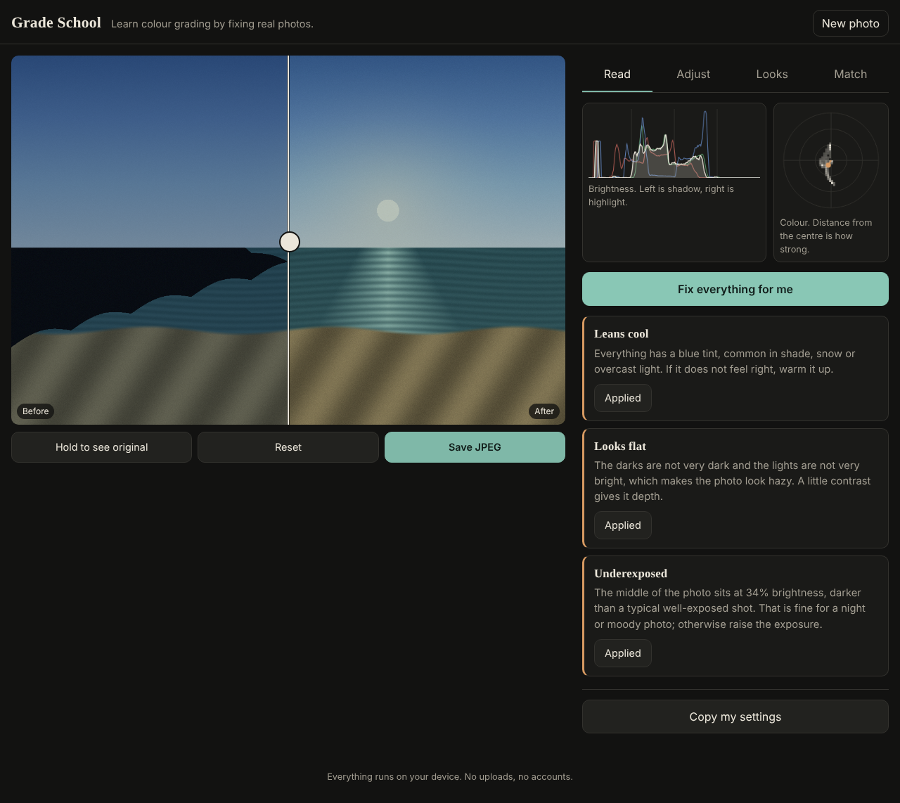
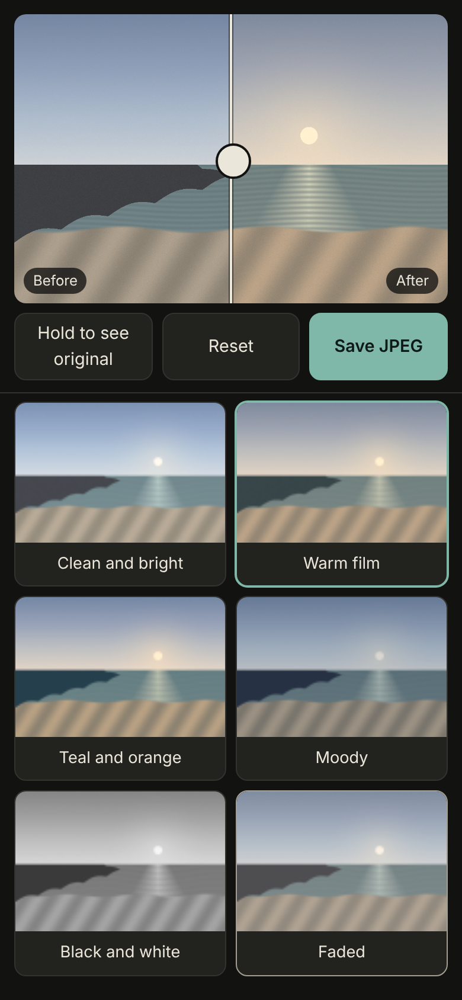

# ColorCraft

A colour grading teacher for beginner photographers. Drop in a photo and it reads the exposure, contrast and colour, explains in plain words what it sees, and lets you fix each problem with one slider or one tap. Runs entirely in the browser: no uploads, no accounts, no dependencies, no build step.

<p>
  
  
</p>

## Try it

Open the live demo (GitHub Pages, once enabled) or run it locally:

```
node scripts/serve.js 8080     # then open http://localhost:8080
npm test                       # 95 tests, Node 22+
python3 scripts/mutation_check.py
```

No photo handy? Three deliberately broken sample photos are built in (too dark and blue, flat and hazy, too orange).

## What it does

- **Read**: brightness histogram, a colour scope, and findings such as "Underexposed", "Highlights are clipping", "Leans warm". Each finding explains itself and has an *Apply this fix* button. *Fix everything for me* runs the auto grade.
- **Adjust**: eight sliders (exposure, contrast, highlights, shadows, temperature, tint, saturation, fade). Each carries a one line explanation of what it does. Double click a slider to reset it.
- **Looks**: seven starting points (warm film, teal and orange, moody, black and white...) with a strength slider. A look is just a set of slider values, so nothing is hidden.
- **Match**: borrow the colour balance of a reference photo, with swatches for both photos.
- Before and after handle (drag or arrow keys), hold to see the original, save a full size JPEG (up to 4000 px), copy your settings as text.

## How it works

All colour maths is in `src/core` with no browser dependencies, so it is testable in Node.

| Piece | Approach |
| --- | --- |
| Colour spaces | sRGB, linear light and CIE Lab (D65), converted through lookup tables for speed |
| Exposure, white balance | gains applied in linear light, where doubling the light really is one stop |
| Highlights, shadows | a gain looked up by each pixel's brightness, smoothly weighted so the other end is untouched |
| Contrast | a power curve pivoted at middle grey |
| Colour cast | a soft-weighted "gray world" estimate: average the mid and bright pixels, giving strongly coloured pixels less say |
| Cast fix | a 2x2 solve, because temperature and tint nudge each other's axis |
| Auto grade | apply fixes, measure again, correct what is left, up to three rounds, keep the best round |
| Match | Reinhard et al. (2001) colour transfer in Lab, with the spread ratio clamped to 0.6 to 1.6 |
| Palette | k-means in Lab with a deterministic start, so the same photo always gives the same swatches |

## Tradeoffs

- **Gray world is a guess.** A photo of a blue sea really is blue. The cast finding is worded as "leans cool, if it does not feel right...", and the estimator down-weights strong colours instead of trusting them, but it can still be wrong on single colour scenes.
- **The preview is a 1280 px copy.** Sliders stay smooth on a phone. Export re-grades the full image (capped at 4000 px) with the same code, so what you see is what you save.
- **No raw support, no local masks, no curves.** This teaches global grading. It is not a Lightroom replacement.
- **Colour is managed as sRGB only.** Wide gamut photos are treated as sRGB.
- **Vanilla JavaScript, no framework.** I planned React and TypeScript, but the package registry was unreachable in my build environment, so I wrote it with zero dependencies. That turned out to suit it: the whole app is static files.

## Things that broke

- **The first cast estimator was biased.** I averaged only "nearly neutral" pixels. On scenes with little true grey it locked onto whatever was least colourful, which was often the cast itself. Switching to a soft weighting fixed it, and a test now checks that a large vivid patch cannot drag the estimate.
- **Fixes fought each other.** Pulling highlights down flattens the photo, which triggers a contrast fix, which clips highlights again. A one shot fix list could make things worse, so the auto grade measures after each round and keeps the best one. On degenerate flat images it used to diverge; "keep the best round" stopped that.
- **Boosting saturation amplified casts.** A cast counts as colour, so a tinted photo looked colourful and a muted one looked fine. The auto grade now settles the cast first and judges saturation after.
- **Black and white photos were called muted.** Tinted monochrome (sepia) has chroma but only one hue. The muted check now compares how varied the colours are against how strong they are.
- **Sample photos hid bugs.** My first "too orange" sample read as cool because the scene was blue dominant. I rebalanced the scene and tested that each broken sample is diagnosed the way it was broken.
- **Float noise in the UI.** A fix showed as `0.7000000000000001`. Fix values are now rounded to slider steps, and a test pins that.

## Testing

95 tests cover the colour maths (round trips, known values), each slider's direction and isolation, the diagnosis rules, the white balance solver and the transfer. `scripts/mutation_check.py` then breaks 20 lines of the maths on purpose (flip a sign, move a pivot, drop a clamp) and requires the suite to fail every time; it initially let 6 through, which is how several of the tests above were found.

The browser layer (`src/main.js`, `src/ui`) is checked by hand with Playwright screenshots at phone and desktop widths, not by automated tests.

## Layout

```
src/core    colour maths, no DOM
src/ui      histogram and scope drawing, slider copy
src/main.js wiring: loading, rendering, tabs
tests       node:test suites
scripts     dev server, mutation check
```
